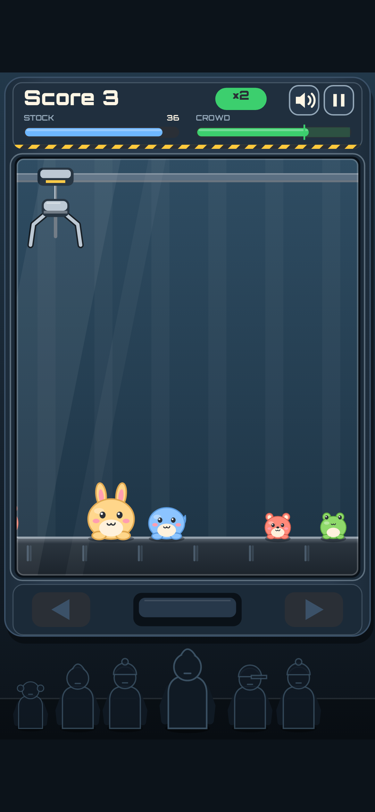
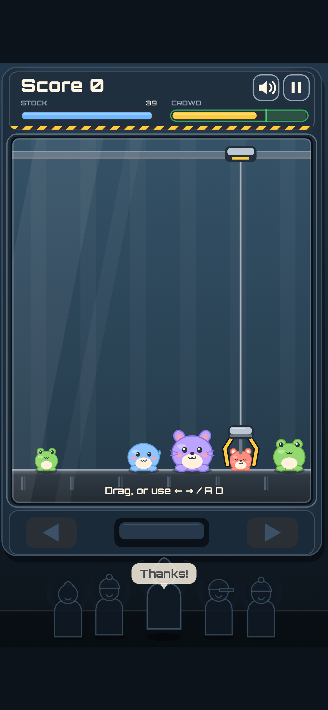
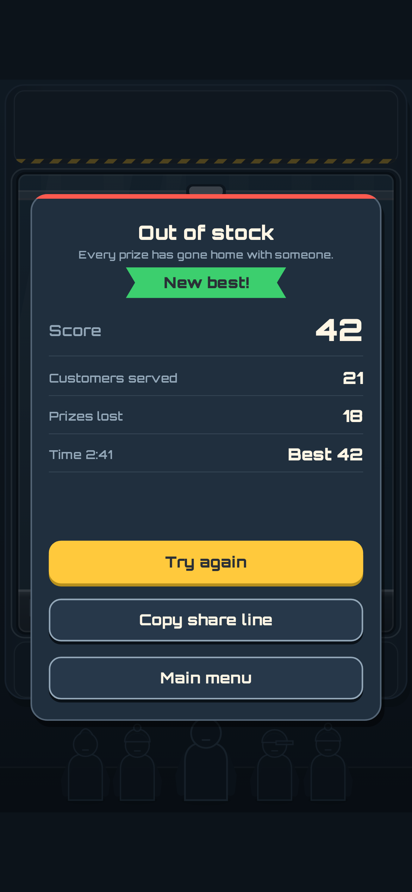
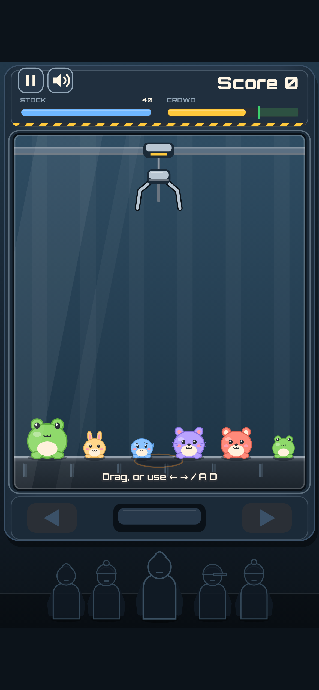
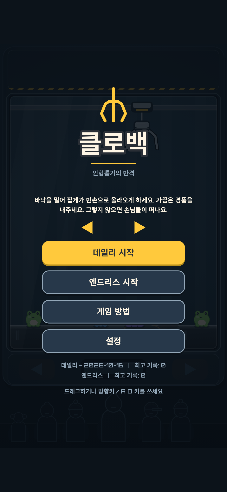

[클로백](/ko/games/clawback/)은 인형뽑기를 뒤집은 게임이에요. 여기서 플레이어는 인형을 뽑는 사람이 아니라 기계예요. 손님이 집게를 내리면 바닥을 좌우로 밀어서 집게가 빈손으로 올라오게 해야 해요. 하지만 가끔은 누군가에게 경품을 내줘야 해요. 그러지 않으면 손님들이 지루해져서 줄이 흩어져요.

이 글에서는 게임을 만든 과정을 이야기해요. 기획, 게임 전체가 기대고 있는 규칙 하나, 그래픽이 생기기도 전에 먼저 플레이한 봇들, 코드로 그린 그래픽과 사운드 순서예요. 스크린샷은 전부 실제 게임 빌드에서 찍었어요.

*플레이 도중 잠깐 한가한 순간. 분위기 막대가 초록색이면 점수가 두 배예요.*

## 조작은 하나뿐, 집게는 거짓말하지 않아요

플레이어가 움직이는 건 바닥뿐이에요. 집게는 건드릴 수 없고, 집게는 언제나 경품을 노리고 내려와요. 내려올 자리를 그림자로 미리 보여 주기 때문에 첫 번째 낙하만 봐도 게임 방법을 다 알 수 있어요.

일부러 이렇게 만들었어요. 집게가 무작위로 빗나간다면 운을 기다리는 게임이 되어 버려요. 클로백의 집게는 절대 제멋대로 빗나가지 않아요. 압박은 집게가 얼마나 자주, 얼마나 빠르게 내려오느냐에서 오고, 피할 수 있는지는 전적으로 플레이어에게 달려 있어요. 덕분에 시뮬레이션도 제대로 테스트할 수 있었는데, 이 이야기는 아래에서 이어 갈게요.

터치, 마우스, 키보드 입력은 모두 "바닥이 어느 쪽으로 움직이는가"라는 값 하나로 바뀌어 같은 게임 로직에 들어가요. 터치에서는 손가락이 닿은 곳으로 바닥이 순간이동하지 않고, 손가락이 움직인 만큼 바닥이 움직여요. 최고 속도는 초당 240px예요. 절충한 부분이에요. 순간이동하면 피하기가 너무 쉬워지니까, 속도에 상한을 둬서 공정하게 맞췄어요.

## 서로 당기는 두 게이지

다 피하기만 하면 되는 게임이라면 게임이 안 되겠죠. 그래서 게이지가 두 개 있어요.

- **재고**는 기계에 남은 경품이에요. 손님이 집에 가져간 경품은 영영 사라지고, 재고가 0이 되면 판이 끝나요.
- **분위기**는 줄 선 손님들의 기분이에요. 빗나갈 때마다 내려가고 누가 경품을 받으면 올라가요. 0이 되면 손님들이 떠나고 판이 끝나요.

경품을 내주면 재고는 줄지만 손님들을 붙잡아 둘 수 있고, 전부 피하면 재고는 지키지만 손님들을 잃어요. 그러니 실제로 고민하는 건 *어떤* 경품을 내줄지예요. 작은 인형, 중간 인형, 큰 인형은 재고를 각각 1, 2, 3씩 쓰고, 처음 기획서에서는 분위기를 3, 7, 12만큼 올려 줬어요. 점수는 응대한 손님 수에 깔끔한 근무 보너스를 더한 값이고, 분위기가 초록 구간에 있는 동안은 ×2 배율이 붙어요.

*누군가 경품을 받았어요. 손님들이 고마워하고, 분위기 막대가 다시 초록색 쪽으로 올라가요.*

## 그림이 생기기 전에 봇이 먼저 플레이했어요

지난 두 게임처럼 클로백도 순수한 로직으로 시작했어요. 처음에는 순수 함수 `step(state, axis)` 하나가 전부였어요. 시드가 같으면 언제나 똑같은 판이 그대로 재현돼요. 모든 무작위 값은 시드, 스트림 이름, 순번에서 나오기 때문에, 같은 시드로 하는 사람은 누구든 경품 벨트와 손님 순서가 똑같아요. 데일리 모드가 공정한 이유도 이거예요. 오늘 날짜가 시드이고, 모두가 같은 판을 받아요.

이런 시뮬레이션이 있으면 테스트 봇 다섯 개가 각각 시드 600개를 약 2초 만에 돌릴 수 있어요. 그림을 그리기 전에 이 봇들로 디자인을 확인했어요.

- 완벽하게 다 피하는 봇은 언제나 져요. 손님들이 지루해지기 때문이에요(첫 버전에서 약 35초).
- 경품을 전부 내주는 봇도 언제나 져요. 재고가 바닥나기 때문이에요(약 68초).
- 균형 잡힌 봇은 중앙값 148초를 버텼어요.

그다음 조정을 한 번 했는데, 바꾼 숫자는 딱 네 개예요. 시작 재고를 40에서 36으로, 빗나갈 때 분위기 감소를 5에서 4로, 중간·큰 인형의 분위기 증가를 7과 12에서 9와 16으로 바꿨어요. 작은 인형을 싸게 만드는 대신 큰 인형의 보상을 올렸어요. 그래야 고민할 거리가 생기거든요. 작은 경품은 오래 버티게 해 주고, 큰 경품은 점수를 더 줘요. 조정 후 균형 잡힌 봇의 중앙값은 148초에서 158초가 됐고, 잘한 판은 대략 104초에서 172초 사이예요. 경품을 한 번도 안 주는 봇은 43초, 항상 주는 봇은 62초에 나가떨어져요.

## 이미지 파일도 오디오 파일도 없어요

클로백에는 이미지나 소리 파일이 하나도 없어요. 기계 본체, 집게, 인형, 손님들, HUD, 메뉴까지 전부 캔버스에 그려요. 소리는 WebAudio로 합성하고, 모든 효과에는 움직임 줄이기 버전이 있어요. 릴리스 전체가 35KB짜리 zip이고, 압축 전 게임 스크립트는 약 79KB로 1MB 한도의 8% 정도예요.

*결과 카드(영어 화면). 다시 도전은 한 번만 탭하면 되고, 공유 문구는 링크 없이 복사돼요.*

## 설정도 신경 썼어요

설정에는 언어(영어와 한국어), 소리, 움직임 줄이기, 왼손 배치가 있어요. 왼손 배치를 켜면 "폰을 다르게 쥐세요" 같은 안내를 띄우는 게 아니라 HUD를 실제로 좌우 반전해요. 움직임 줄이기는 직접 고르기 전까지 기기 설정을 따라가요. 그래서 이 설정이 필요한 사람은 처음 실행할 때부터 바로 적용돼요.

*왼손 배치.*

한국어 화면도 실제 사이트에서 찍었어요. 분위기, 재고 같은 게임 용어는 고민해서 골랐고, 손님 종류마다 말투도 달라요.

*한국어 타이틀 화면. 부제는 "인형뽑기의 반격"이에요.*

## 걸린 시간과 아직 확인하지 못한 것

착수부터 릴리스 빌드까지 3시간 13분이 걸렸어요. 결정을 기다린 약 1시간도 포함한 시간이에요. 뺀 기능은 하나도 없어요. 데일리와 엔드리스 모드, 두 언어, 어린이 손님, 효과, 설정이 모두 들어갔어요.

아직 못 한 일도 있어요. 클로백을 실제 휴대폰에서 플레이해 본 사람은 아직 없고, iOS Safari 확인도 건너뛰었어요. 오디오 믹스를 직접 들어 본 사람도 없어요. 소리는 만들어서 연결해 두었지만, 사람이 듣고 판단한 적은 없어요. 해 보고 어딘가 어색하면 꼭 알려 주세요.

[클로백에서 한 번 근무해 보세요](/ko/games/clawback/). 손님들을 얼마나 오래 붙잡아 둘 수 있을까요?
