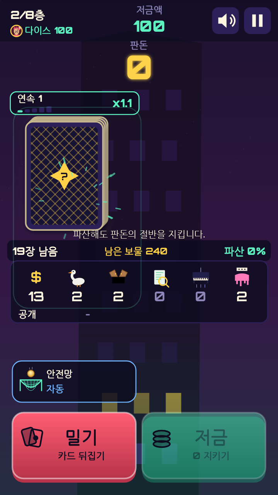
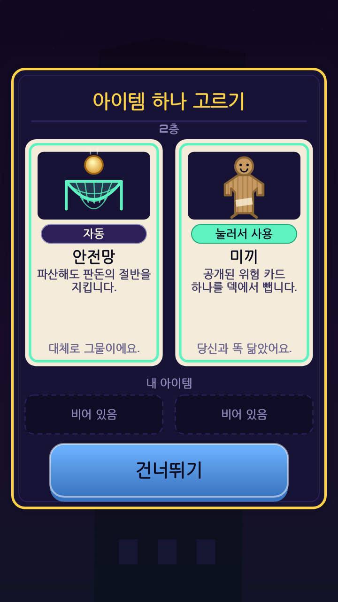
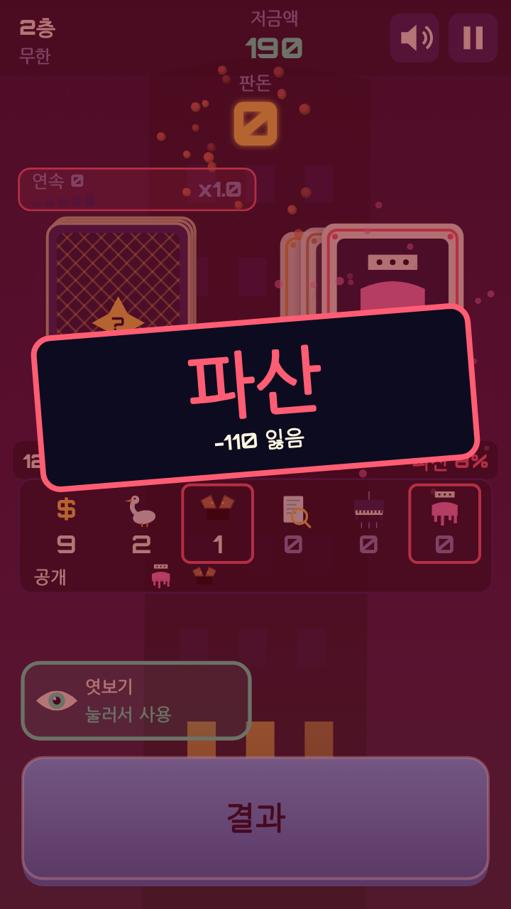
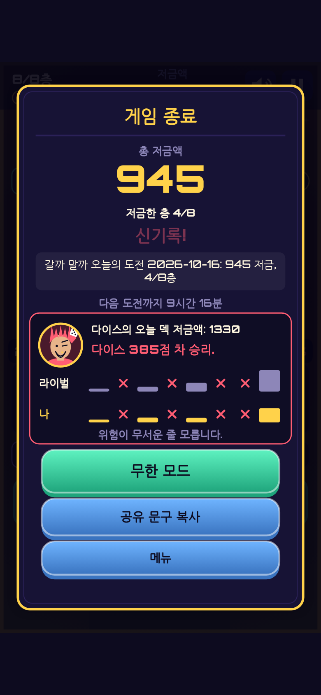

[갈까 말까](/ko/games/double-or-quits/)(Double or Quits)는 건물을 한 층씩 올라가는 카드 게임이에요. 층마다 뒤집힌 덱이 있고, 카드를 한 장 뒤집으면 판돈이 늘거나 위험 카드가 나와요. 거위, 함정문, 젖은 페인트, 세무조사, 떨어지는 피아노 같은 것들이에요. 같은 종류의 첫 번째는 괜찮아요. 두 번째가 나오면 그 층이 끝나고, 저금하지 않은 판돈을 전부 잃어요. 카드를 뒤집을 때마다 선택하게 돼요. **밀기**로 한 장 더 뒤집을지, **저금**으로 판돈을 지킬지요.

다섯 번째 게임이고, 다섯 번째 조작 방식이에요. 오르빗 홉은 한 번 탭, 라인 인스펙터는 스와이프 판정, 클로백은 집게 조종, 밤에 피는 꽃은 선을 그어 자르기였어요. 이번에는 새로운 동사, 밀기와 저금이에요. 이 글은 가장 중요했던 설계 문제 하나, 그걸 봇으로 어떻게 확인했는지, 그리고 생각만큼 깔끔하지 않았던 부분을 다뤄요.

*한국어 화면의 2층. 카운터가 덱에 남은 카드를 그대로 보여 줘요.*

## "그냥 운이잖아"라는 문제

밀기와 저금 방식의 게임은 평이 좋지 않고, 그럴 만해요. 매번 뒤집는 카드가 가려진 동전 던지기라면 잘하는 사람이나 아무렇게나 하는 사람이나 결과가 비슷해지니까요. 그런 걸 내놓고 싶지 않았어요.

해결책은 읽을 수 있는 덱이에요. 층마다 시드로 새로 섞은 덱이 나오고(1층은 16장, 8층은 35장), HUD에는 남은 카드가 항상 보여요. 한 번 공개된 위험 카드 종류는 다음에 또 나오면 파산이에요. 그래서 HUD에 다음 한 장의 정확한 **파산 확률**을 보여 줘요. 이미 공개된 위험 카드 종류의 남은 장수를 남은 카드 수로 나눈 값이에요. 보물 카드는 그냥 더하기이고 배수는 없어요. 판돈이 0이면 저금 버튼이 꺼져 있으니, 한 층의 첫 번째 카드로는 절대 파산하지 않아요.

덕분에 한 장 한 장이 확률 판단이 돼요. 0%면 당연히 밀어요. 공짜니까요. 판돈이 두둑한데 30%라면 정말로 생각해야 하죠. 덱을 세는 사람은 세지 않는 사람보다 더 좋은 때에 저금해요.

화면에 뜨는 숫자를 그냥 믿고 싶지는 않았어요. 그래서 파산 확률을 전수 계산과 비교했어요. 시드 500개, 결정 지점 32,675곳에서 불일치는 0건이었어요.

*2층의 아이템 선택. 둘 중 하나를 고르거나 건너뛰어요.*

## 실력인지는 봇이 알려 줘요

게임 규칙은 캔버스도 소리도 시계도 없는 순수한 시드 시뮬레이션이라서, 같은 시드는 언제나 같은 층을 만들어요. 테스트 스크립트 `levelcheck`는 봇 네 개로 수백 개의 시드를 돌리고, 시뮬레이션이 넘지 말아야 할 선을 넘으면 빌드를 실패시켜요(가져올 수 있는 건 config, rng, sim, bots뿐이고 `Math.random`, 시계, DOM, 캔버스, 오디오는 쓸 수 없어요).

최종 빌드에 남긴 데일리 시드 1000개의 결과예요.

- **확률을 읽는 봇**(파산 확률을 보고 저금 시점을 정해요): 중앙값 1184점.
- **무작위 봇**: 중앙값 531점. 2.23배 차이이고, 확률을 읽는 봇이 시드의 93.2%에서 직접 맞붙어 이겨요.
- **욕심쟁이 봇**(파산할 때까지 저금하지 않아요)은 시드의 84%에서, **신중한 봇**(일찍 저금해요)은 87%에서 확률을 읽는 봇에게 져요.
- 튜닝에 쓰지 않은 시드에서는 2.37배, 승률 95.9%였어요.

한 판은 결정 약 49번, 대략 2분이에요. 확률을 읽는 봇의 파산율은 1~8층에서 30, 38, 43, 48, 42, 49, 50, 51%예요. 신중한 봇은 2~8%만 파산하고 욕심쟁이 봇은 46~100%예요. 저금은 모든 층에서 진짜 선택이에요.

처음 버전은 더 단순한 덱이었어요. 시간을 더 받으면서 깊이를 더하기로 했고, 새 기능은 전부 제 몫을 해야 했어요. 특수 카드(두 배, 싹쓸이, 징크스), 5~8층의 층 변형(골드러시, 조용한 층), 연속 저금 한 층마다 +10% 보너스는 모두 확률을 읽는 봇의 중앙값을 올려야 자리를 얻었어요. 특수 카드가 없으면 985, 층 변형이 없으면 987, 연속 보너스가 없으면 1112이고, 전부 있을 때는 1183이에요. 일찍 저금하면 주는 고정 보너스(신중한 봇이 확률을 읽는 봇을 이기게 됐어요), 위험 카드 종류 추가, 아이템 중첩, 층 전체 판돈 두 배는 시험해 보고 버렸어요.

*무한 모드에서의 파산. 붉은 테두리가 쳐진 위험 카드는 이미 공개된 종류라서, 카운터가 다음 한 장이 파산이라고 알려 주고 있었어요.*

## 서로 다르게 플레이하는 라이벌 셋

데일리 모드에서는 봇 성격 셋 중 하나와 겨뤄요. 같은 시드를 브라우저 안에서 그대로 시뮬레이션하고, 서버는 쓰지 않아요. 페니는 모으고, 다이스는 모험하고, 스트릭은 연속 저금을 쫓아요. 점수는 비슷하지만(그중 둘의 중앙값은 13% 안쪽이에요) 플레이는 전혀 달라요. 시드 1000개에서 스트릭 같은 추격형은 평균 5.62층을 저금하고, 다이스 같은 모험형은 3.93층을 저금해요. 초반에 해 본 QA 플레이 테스트에서 라이벌이 이길 수 없어 보인다는 의견이 나와서, 라이벌의 진행 중 점수를 상단 바에 보여 주기로 했어요. 경주 중이라는 게 보이도록요.

## 솔직한 이야기

**아이템 선택은 거의 중요하지 않아요.** 2, 4, 6층에서 다섯 가지 아이템(우산, 엿보기, 안전망, 미끼, 자루) 중 둘이 나오고 하나를 골라요. 슬롯은 두 칸이에요. 똑똑한 선택이 중요하길 바랐지만, 대체로 아니에요. 똑똑하게 고르는 봇이 무작위로 고르는 봇을 이기는 비율은 48%뿐이에요. 다섯 아이템의 가치가 서로 약 6% 안쪽이기 때문이에요. 아이템이 있다는 것 자체는 약 14%의 가치가 있어요. 그러니 선택은 대부분 취향이고, 합격 기준도 "똑똑한 선택이 무작위보다 나쁘지 않을 것"으로 낮췄어요.

**12px 글자 크기를 맞추는 데 QA가 세 번 필요했어요.** QA 담당이 첫 릴리스 후보(v1.0.0)에서 대비가 낮은 글씨와 360x640에서 약 9px인 캡션을 찾아냈어요. 두 번째 라운드(v1.0.1)에서는 QA가 지적한 캡션만 고쳤고, 다시 확인하니 다른 캡션이 아직 7~10px이었어요. 세 번째(v1.0.2)에서 제대로 했어요. 공용 최소 글자 크기 하나를 글자 그리기 함수 안에서 강제해서, 모든 캡션이 예외 없이 거치게 했어요. 결과는 통과예요. 가만히 떠 있는 모든 캡션이 360x640에서 12px, 390x844에서 13px이고 영어와 한국어 모두 같아요. 전부 가독성과 다듬기 문제였고 규칙, 시뮬레이션, 입력 결함은 없었어요.

*데일리 결과 화면. 공유 문구에는 URL이 들어 있지 않아요.*

## 작게 만들고, 두 언어로

그래픽은 전부 540x960 세로 캔버스 2D에 코드로 그리고, 소리는 WebAudio로 합성해서 이미지나 오디오 파일이 없어요. 사인파 드론 두 개와 맥박으로 된 긴장 레이어는 긴장도 값 하나를 따라가고, 보물 소리는 빈 판돈에서 기준 판돈까지 한 옥타브 올라가서 판돈이 커지는 걸 귀로 들을 수 있어요. 릴리스는 런타임 의존성 없는 124KB짜리 `game.js` 하나예요. 다시 도전은 약 1ms 만에 새 판을 시작하고, 데일리는 UTC 날짜가 시드이며 도전은 한 번뿐이에요.

한국어도 완전히 지원해요. 제목 '갈까 말까'는 "Double or Quits"가 글자 그대로 옮겨지지 않아서 붙인 이름이고, 교정 담당도 이쪽이 더 낫다고 확인해 줬어요. 교정에서 수정 8곳이 나왔고, 그중 하나는 꼭 고쳐야 하는 거였어요. 라이벌 이름에 따라 달라져야 하는 조사가 그대로였다면 "스트릭와"라고 찍혔을 거예요.

## 아직 확인하지 못한 것

QA는 휴대폰 에뮬레이션을 켠 헤드리스 Chromium에서 했고, 실제 휴대폰이나 실제 WebKit은 아니에요. **아직 아무도 이 게임의 소리를 들어 보지 못했어요.** QA는 헤드리스 샌드박스에서 했어요. 한국어 글자는 기기에 설치된 글꼴을 쓰는데, 실제 휴대폰이 아니라 한글 글꼴을 넣어 둔 환경에서만 확인했어요. 공유 문구 복사 버튼의 클립보드 동작은 테스트하지 않았어요. 밸런스 수치는 전부 봇에서 나온 값이고, 많은 사람이 해 본 결과가 아니에요.

어딘가 어색하면 알려 주세요.

[갈까 말까 플레이하기](/ko/games/double-or-quits/). 덱을 읽으며 얼마나 오래 버틸 수 있는지 확인해 보세요.
