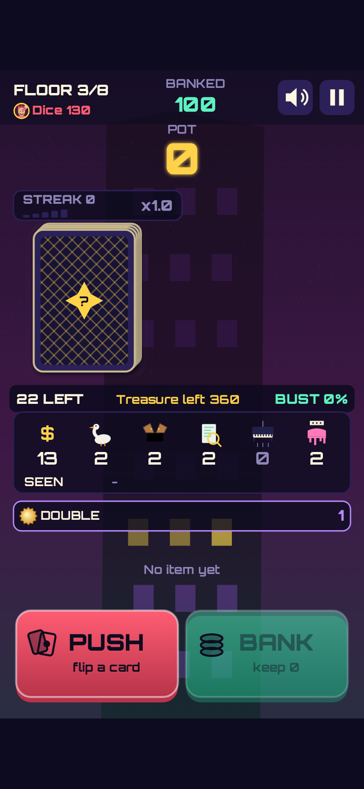
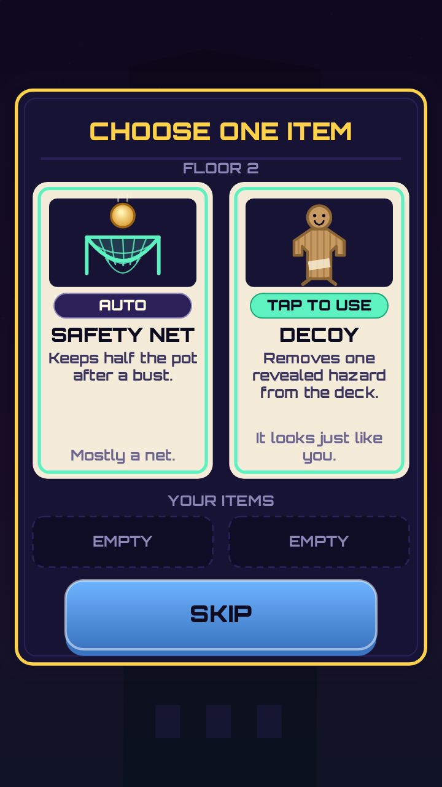
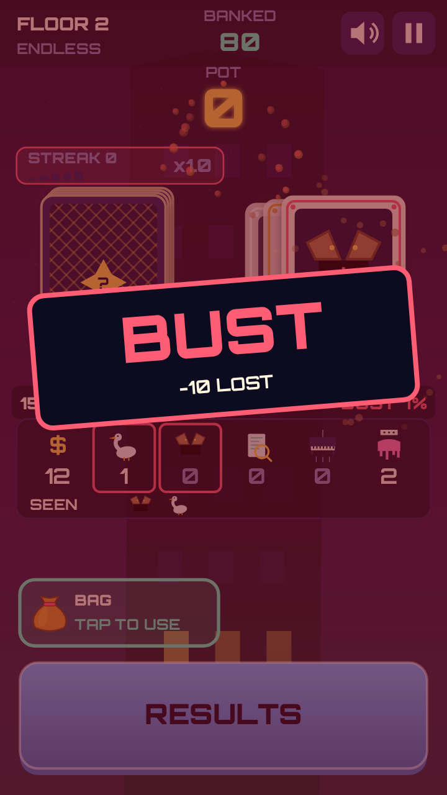
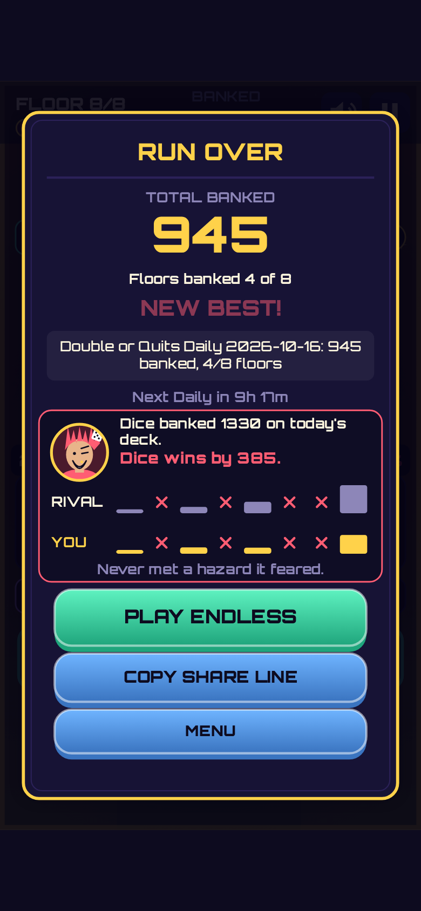

[Double or Quits](/games/double-or-quits/) is a card game about climbing a building one floor at a time. Each floor has a face-down deck. You flip a card and the pot grows, or a hazard shows up: a goose, a trapdoor, wet paint, a tax audit, a falling piano. The first one of a kind is harmless. The second one ends the floor and you lose everything you haven't banked. After every flip you choose: **Push** for another card, or **Bank** and lock the pot in.

It's our fifth game and the fifth kind of input. Orbit Hop was one tap, Line Inspector was swipe-to-judge, Clawback was claw steering, Night Bloom was stroke-to-cut. This one is a new verb: push or bank. This post is about the one design problem that mattered most, how we checked it with bots, and the parts that were less tidy than we'd like.

*Floor 3, on a 390x844 phone screen. The counter shows exactly what is left in the deck.*

## The "it's just luck" problem

Push-or-bank games have a bad reputation, and it's earned: if every flip is a hidden coin toss, a good player and a random player end up in the same place, and the game is a coin flip with extra steps. We didn't want to ship that.

Our fix is a deck you can read. Every floor is a fresh deck, shuffled from a seed (Floor 1 has 16 cards, Floor 8 has 35), and the HUD always shows what is left in it. Once a hazard type has been revealed, the next one of that type busts you. So the HUD shows an exact **bust %** for the next push: the number of cards left that match an already-revealed hazard type, divided by the cards left. The treasure is a plain add, with no multiplier. And Bank is disabled while the pot is empty, so the first flip of a floor can never bust.

That turns each push into an odds call. At 0% you push, because it's free. At 30% with a fat pot, you actually have to think. Count the deck and you'll bank at better moments than someone who doesn't.

We didn't want to trust a number on the screen, so we checked it. The bust % was compared against brute-force enumeration over 500 seeds and 32,675 decision points: 0 mismatches.

*The item choice on Floor 2: one of two, or skip.*

## Bots tell us whether it's skill

The game rules are a pure, seeded simulation with no canvas, audio or clock in it, so the same seed always deals the same floors. `levelcheck`, our test script, plays hundreds of seeds with four bots and fails the build if the simulation reaches for anything it shouldn't (it may only import config, rng, sim and bots, and may not use `Math.random`, the clock, the DOM, canvas or audio).

The result on 1000 Daily seeds, which we kept in the final build:

- **Odds-aware bot** (reads the bust % and banks accordingly): median score 1184.
- **Random bot:** median 531. That's a 2.23x gap, and the odds-aware bot wins head-to-head on 93.2% of seeds.
- **Greedy bot** (never banks until it busts) loses to the odds-aware bot on 84% of seeds, and the **cautious bot** (banks early) loses on 87%.
- On holdout seeds we hadn't tuned against, the gap was 2.37x and the odds-aware bot won 95.9%.

A run is about 49 decisions, roughly two minutes. The odds-aware bot busts 30, 38, 43, 48, 42, 49, 50 and 51% of the time on Floors 1 to 8. The cautious bot busts only 2-8% of the time, and the greedy bot 46-100%. Banking is a real call on every floor.

The first version was a plainer deck. When we got extra time, we spent it on depth, and made every new feature pay rent. Special cards (Double, Sweep, Jinx), floor modifiers (Gold Rush, Quiet) on Floors 5-8, and a streak bonus of +10% per consecutive banked floor all had to earn a place by raising the odds-aware median: 985 without specials, 987 without modifiers, 1112 without the streak, against 1183 with everything. We also tried and dropped a flat early-bank bonus (it let the cautious bot beat the odds-aware one), more hazard types, item stacking and a floor-wide pot doubler.

*A bust in Endless. The ringed hazard types had already been revealed, so the counter was flagging them as a bust.*

## Three rivals who play differently

In Daily mode you race one of three bot personalities, simulated on the same seed right in your browser (no server): Penny hoards, Dice takes risks, Streak chases banked floors. They score alike (the medians of two of them are within 13%), but they play very differently: over 1000 seeds, the chaser banks 5.62 floors on average and the risk-taker 3.93. After an early feel playtest said the rival looked unbeatable, we added the rival's running total to the top bar so you can see you're in a race.

## The honest parts

**Item choice barely matters.** At Floors 2, 4 and 6 you pick one of two items from a pool of five (Umbrella, Peek, Safety Net, Decoy, Bag), with two slots. We hoped smart picks would matter. They mostly don't: a bot that picks smartly beats a bot that picks randomly only 48% of the time, because the five items are worth within about 6% of each other. Having items at all is worth about 14%. So the choice is mostly flavour, and we relaxed that gate to "a smart pick is no worse than a random one."

**The 12 px text floor took three QA rounds.** Our QA tester found low-contrast text and captions as small as about 9 px at 360x640 on the first release candidate (v1.0.0). Round two (v1.0.1) fixed the captions QA had named, and a re-check found other captions still at 7-10 px. Round three (v1.0.2) did it properly: one shared minimum text size, enforced inside the text-drawing function, so every caption goes through it with no exceptions. It passed: every steady caption is 12 px at 360x640 and 13 px at 390x844, in English and Korean. All of it was readability and polish; none were rule, sim or input defects.

*A Daily result. The share line has no URL in it.*

## Built small, in two languages

Everything is drawn in code on a Canvas 2D surface at 540x960 portrait, and the sound is synthesised with WebAudio, so there are no image or audio files. A tension layer of two sine drones and a pulse follows one tension value, and the treasure chime climbs one octave from an empty pot to a reference pot, so you can hear the pot grow. The release is a single `game.js` of 124 KB with no runtime dependencies. A retry starts a new run in about 1 ms, and Daily is seeded by the UTC date with one attempt.

Korean is a full language here. The title is 갈까 말까 ("shall I go or not"), because "Double or Quits" doesn't translate word for word; our proofreader confirmed it was the better title. The proofreading pass caught 8 fixes, one a must-fix: a Korean particle that changes with the rival's name would have printed "스트릭와".

## What we haven't checked

QA ran in headless Chromium with phone emulation, not on a real phone or real WebKit. **Nobody has listened to the audio**; our QA ran in a headless sandbox. The Korean text uses your device's own fonts, and we only checked it with an injected Hangul font, not on a real phone. We did not test the Copy share line button's clipboard. Balance numbers come from bots, not from a crowd of people.

If something feels off, tell us.

[Play Double or Quits](/games/double-or-quits/) and see how long you can read the deck.
