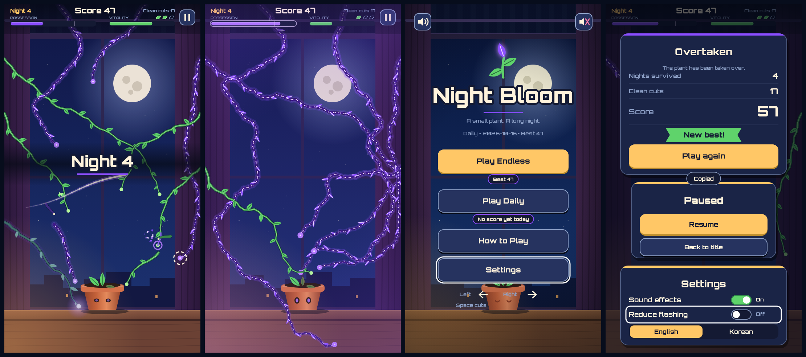
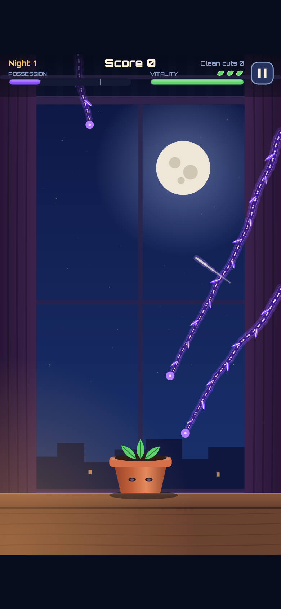
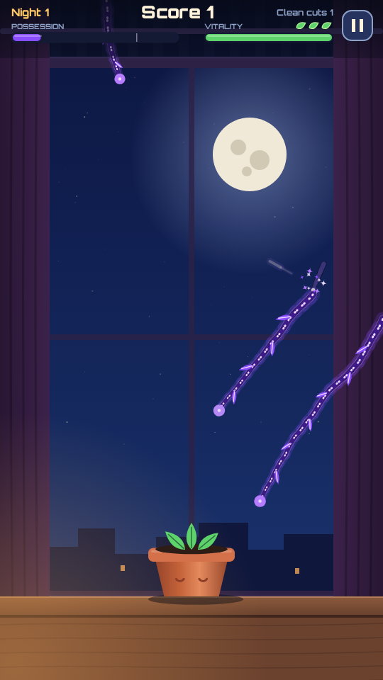
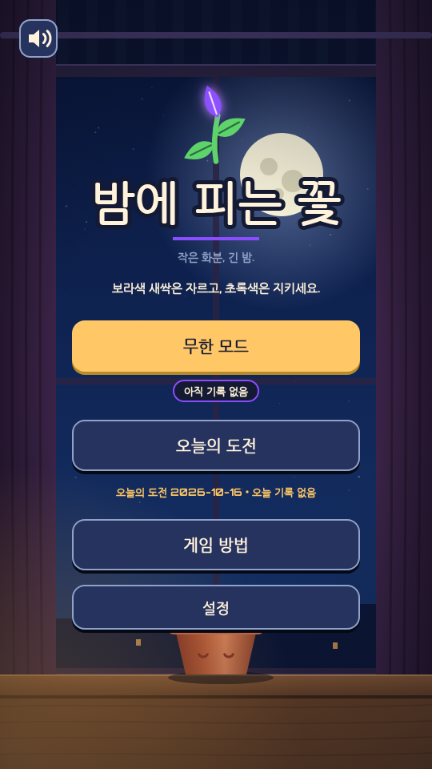

[밤에 피는 꽃](/ko/games/night-bloom/)(Night Bloom)은 화분 식물이 새싹 하나씩 차례로 빙의되는 게임이에요. 보랏빛으로 빛나는 새싹이 화분 쪽으로 뻗어 와요. 화면에 빠르게 선을 그어서, 새싹이 화분에 닿기 전에 잘라 내야 해요. 문제는 건강한 초록 새싹이 저주받은 새싹 사이에 뒤엉켜 자란다는 거예요. 건강한 새싹을 자를 때마다 식물이 약해져요.

저희의 네 번째 게임이자 네 번째 조작 방식이에요. Orbit Hop은 탭 한 번, Line Inspector는 스와이프로 판정하기, 클로백은 좌우 조종이었어요. 이번에는 선을 그어 자르기예요. 이 글에서는 기획, 두 개의 게이지, 그래픽이 생기기도 전에 게임을 먼저 플레이한 봇들, 그리고 아직 확인하지 못한 부분을 이야기해요. 스크린샷은 전부 실제 빌드에서 찍었어요.

*아트 키트 화면 네 장. 여기 보이는 건 전부 코드로 그렸어요.*

## 선 하나로, 새싹 여러 개를

손가락이나 마우스로 화면을 가로질러 드래그하면, 선이 지나간 새싹이 모두 잘려요. 내부적으로 새싹은 시드로 만든 폴리라인이고, 자르기는 선분 교차 검사예요. 덕분에 게임 규칙은 캔버스, 소리, 시계와 상관없는 작은 순수 시뮬레이션으로 둘 수 있어요. 키보드에서는 좌우 방향키로 새싹을 고르고 스페이스바로 자르니까, 포인터 없이도 플레이할 수 있어요.

저주받은 새싹과 건강한 새싹은 한눈에 구분돼야 하고, 색깔에만 기대서도 안 돼요. 그래서 저주받은 새싹에는 빛무리, 점선 하이라이트, 끝이 뾰족하고 톱니가 있는 잎, 달아오른 듯 빛나는 끝부분까지 붙어 있어요. 초록과 보라를 구분하기 어려운 사람도 알아볼 수 있게 하려는 거예요. 빛무리는 블러 필터 대신 반투명한 선 두 겹으로 그려요. 새싹 여덟 개를 초당 60프레임으로 그릴 때는 이쪽이 더 가볍고, 휴대폰에서 프레임이 떨어지면 가장 먼저 뺄 효과이기도 해요.

*터치로 자르는 장면. 390×844 휴대폰 화면을 에뮬레이션해서 찍었어요.*

## 게이지 두 개, 지는 방법도 두 가지

- **빙의**는 저주받은 새싹이 자라는 동안 올라가요. 가득 차면 끝이에요.
- **생기**는 건강한 새싹을 자르면 내려가요. 0이 되면 끝이에요.

그러니 전부 베어 버릴 수도 없고, 머뭇거릴 수도 없어요. 건강한 새싹을 자를 때마다 생기가 34씩 줄어서 세 번 실수하면 끝나요. 더 너그러운 30으로도 해 봤는데, 판이 너무 길어졌어요. 한 판 길이의 중앙값이 3분 9초가 되고, 목표인 1~4분 안에 드는 판은 81%뿐이었어요. 그래서 34는 그대로 두고 진행 속도를 조정했어요.

한 판은 약 30초짜리 "밤"으로 나뉘어요. 밤이 지날수록 새싹이 더 빨리 자라고 더 많이 엉켜요. 후반 밤에는 미끼 새싹도 나와요. 멀쩡해 보이다가 중간쯤 자라서 저주받는 새싹이에요. 점수는 버틴 밤 수에 10을 곱하고 깔끔한 컷 수를 더한 값이에요. 그래서 운 좋게 몇 번 잘 자른다고 오래 버틴 것보다 점수가 높아지지는 않아요.

## 그림이 생기기 전에 봇이 먼저 플레이했어요

앞선 게임들처럼 밤에 피는 꽃도 순수한 `step(state, dt, input)` 함수로 시작했어요. 시드가 같으면 언제나 똑같은 판이 그대로 재현돼요. '오늘의 도전' 모드가 공정한 이유도 이거예요. UTC 날짜가 시드라서 모두가 같은 식물을 받아요.

테스트 스크립트는 봇 하나당 시드 1000개를 약 15초 만에 돌려요. 그림이 하나도 없던 때에 네 가지 봇으로 디자인을 확인했어요.

- 아무것도 안 하는 봇은 중앙값 21초 만에 빙의로 져요.
- 아무 데나 자르는 봇은 약 27초 만에 생기가 바닥나요.
- 신중한 봇은 중앙값 2분 37초를 버텨요(하위 5%는 83초, 상위 5%는 238초). 선의 83%가 저주받은 새싹에 맞고, 79%는 깔끔하게 잘라요.
- 키보드 봇은 가장 느린 조작 방식을 쓰지만, 신중한 봇보다 약 1.2배 오래 버텨요.

초기 버전은 목표에 못 미쳤어요. 튜닝에 쓰지 않은 시드에서 신중한 봇이 1~4분 안에 끝낸 비율이 87.8%였고, 목표는 90%였어요. 튜닝 한 번으로 해결했는데, 코드는 건드리지 않고 설정 파일의 숫자 여섯 개만 바꿨어요. 첫 번째 밤은 더 쉽게(새싹 사이 간격 3.2초, 속도는 초당 66px로 낮춤), 다섯·여섯 번째 밤은 더 빠르게, 무한 모드의 가속은 더 가파르게 만들고, 빙의 속도는 3.1에서 3.3으로 올렸어요. 결과는 처음 보는 시드에서 90.0%예요. 기준선에 딱 걸쳐 있어서 여유가 거의 없다는 건 미리 말해 둘게요.

엄지가 서툰 경우도 확인했어요. 봇의 조준 오차를 14px / 8°에서 34px / 20°로 넓히면 명중률이 83%에서 62%로 떨어지지만, 한 판은 여전히 2.3~2.6분 동안 이어져요. 휴대폰에서 대충 그으면 생기는 더 빨리 줄지만, 게임은 계속할 수 있어요.

*저주받은 새싹을 잘랐을 때: 반짝이는 입자 열 개와 싹둑 소리. 건강한 새싹을 자르면 대신 잎이 떨어지고 한숨 소리가 나요.*

## 이미지 파일도 오디오 파일도 없어요

밤에 피는 꽃에는 이미지나 소리 파일이 하나도 없어요. 식물, 화분, 창틀, HUD, 메뉴는 물론 화살표, 점, 잎 모양 표시까지 전부 캔버스에 그려요. 소리는 WebAudio로 합성하고, 음악은 가단조 16스텝 오르골 루프예요. 빙의 게이지가 찰수록 음이 어긋나요. 유령 같은 두 번째 성부가 최대 45센트까지 어긋나고, 템포는 8% 느려져요. 모든 효과에는 '움직임 줄이기' 버전이 있어요. 이 설정은 직접 바꾸기 전까지 기기 설정을 따라요.

게임 스크립트는 전부 합쳐 약 85KB로 1MB 예산보다 훨씬 작고, 릴리스 zip은 37KB예요. '다시 하기'를 누르면 약 115ms 만에 새 판이 시작돼요.

## 이미 쓰이고 있는 제목

밤에 피는 꽃은 영어로 Night Bloom이에요. 교정 담당이 알려 줬는데, 같은 제목의 2024년 한국 드라마가 있어요. 게임 제목으로는 문제될 게 없지만, 알아 둘 만해요. 한국어도 영어와 똑같이 게임 전체에 들어가 있어요. 문자열 56개를 한국어로 쓰고 교정까지 거쳤고, 작은 게이지 라벨에 들어가도록 용어를 골랐어요(Possession은 빙의, Vitality는 생기). 교정에서 작은 수정이 여섯 군데 나왔고, 그중 세 군데는 뜻이 잘 안 읽히던 게임 방법 안내였어요.

*한국어 타이틀 화면.*

## 걸린 시간과 아직 확인하지 못한 것

착수부터 태그가 붙은 릴리스 빌드까지 약 한 시간이 걸렸어요. 잡아 둔 시간은 3~4시간이었어요. 뺄 기능 목록에서 실제로 뺀 건 하나도 없어요. 미끼 새싹도, 오르골 음 어긋남도 모두 들어갔어요.

아직 못 한 일도 있어요. **이 게임 소리를 들어 본 사람이 아직 없어요.** 테스트 환경에 소리 장치가 없어서 효과음과 음 어긋남은 재생이 예약되는지만 확인했어요. 실제 휴대폰이나 Safari에서 직접 플레이해 본 사람도 없어요. 터치는 에뮬레이션이었고, 기기에서 프레임 속도도 재지 못했어요. 사람이 직접 플레이 테스트를 한 적도 없어요. 위의 밸런스 수치는 전부 봇에서 나온 값이고, 키보드 봇의 타이밍은 가정한 값이에요. 한국어 화면은 대체 글꼴로 확인했기 때문에, 여러분 기기에서는 줄바꿈이 조금 다를 수 있어요.

해 보고 어딘가 어색하면 꼭 알려 주세요.

[식물을 구하러 가 보세요](/ko/games/night-bloom/). 몇 번째 밤까지 버틸 수 있을까요?
